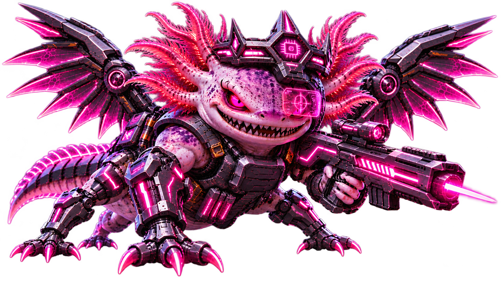

<table width="100%">
<tr>
<td align="center">

<h3>Software Developer | Embedded Systems | Mobile &amp; Web</h3>

Computer Science student &amp; certified Software Developer and QA.

<i>From a curious axolotl to the ultimate Mega Axolotl.</i>

</td>
</tr>
</table>

<table width="100%">
<tr>
<td align="center">

<strong>Tech Stack</strong>

<code>Java</code> <code>Python</code> <code>C</code>
<code>C++</code> <code>C#</code> <code>Dart</code>

<code>Flutter</code> <code>ESP32</code>
<code>Arduino</code> <code>Raspberry Pi</code>
<code>IoT</code>

</td>
</tr>
</table>

