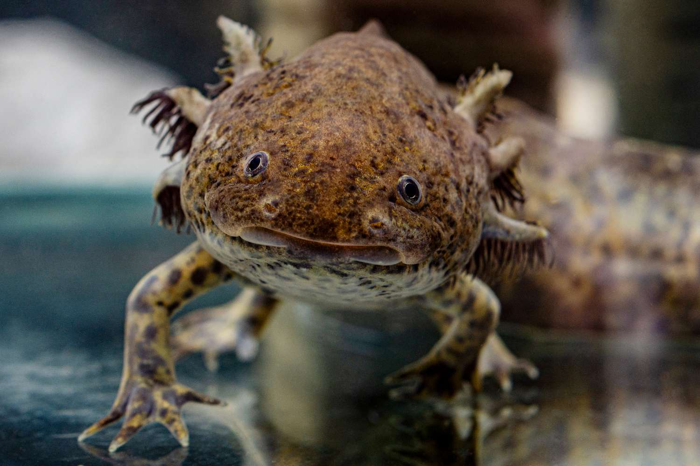

<h1>Hey there, I'm Stav!</h1>

<h3>Software Developer | Embedded Systems | Mobile & Web Development</h3>

<i>Just an axolotl with a head full of questionable ideas, a passion for building gadgets, and a dream of evolving into the ultimate Mega Axolotl.</i>

I'm a second-year Computer Science student, certified in Software Development and Quality Assurance (QA).

I love building gadgets, experimenting with microcontrollers, combining hardware with software, and turning ridiculous sci-fi ideas into actual projects.

Sometimes I build things to solve problems. Sometimes I build things because they sound cool at 3 AM.

<b>Ultimate goal:</b> Build enough gadgets to evolve into a Mega Axolotl.

<h2>Tech Stack</h2>

<h3>Programming Languages</h3>

<code>Java</code> <code>Python</code> <code>C</code> <code>C++</code> <code>C#</code> <code>Dart</code>

<h3>Development</h3>

<code>Flutter</code> <code>Mobile Development</code> <code>Web Development</code> <code>Embedded Systems</code> <code>IoT</code>

<h3>Hardware & Electronics</h3>

<code>Microcontrollers</code> <code>ESP32</code> <code>Arduino</code> <code>Raspberry Pi</code> <code>Sensors</code> <code>Hardware-Software Integration</code>

<h2>Featured Projects</h2>

<h3>SonicCore — Multi-Channel Audio System</h3>

A custom ESP32-based audio system designed for Bluetooth audio streaming, stereo audio routing, multiple amplifiers, speaker control, and a display interface.

Currently working on the hardware architecture, firmware development, and system integration.

<a href="https://github.com/StavLibi/Esp32-sonic">Explore SonicCore</a>

<h3>ESP32 Flutter AI Math Bridge</h3>

A Flutter-based mobile application communicating with an ESP32 over Bluetooth to process mathematical requests locally or through AI integration.

<a href="https://github.com/StavLibi/ESP32-Flutter-AI-Math-Bridge">Explore the Project</a>

<h2>Connect With Me</h2>

<a href="https://www.linkedin.com/in/stav-ganz-a264213b8/">LinkedIn</a>

<i>Building things nobody asked for, one commit closer to becoming a Mega Axolotl.</i>

